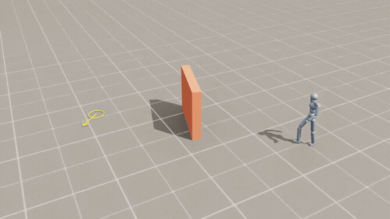

# Cost-Guided Humanoid Motion Generation

**Can a humanoid adapt learned motion to obstacles at inference time, without additional training?**

An undergraduate personal project built with MimicKit and Isaac Lab. I started with a PPO reference tracker, collected physical rollouts, trained MLP and diffusion models, and explored obstacle avoidance through cost guidance. The final system uses a learned action decoder conditioned on future root motion.

[](reports/assets/readme_demo/wall_scene11_heading60_isaac_12s.mp4)

[Watch the Isaac Sim capture · 12-second MP4](reports/assets/readme_demo/wall_scene11_heading60_isaac_12s.mp4)

**Walking around a 1.8 m wall to a goal about 6.36 m away, then stopping with a 60° leftward change in heading.** This is an Isaac Sim replay of a recorded physical rollout using cost-guided diffusion. No analytic root-path correction was applied after generation.

<details>
<summary>Demo conditions and evaluation scope</summary>

This additional demo uses scene 11's obstacle layout and goal distance, with a target heading of +60° relative to the initial heading and sampling seed 4504. Its starting rollout frame also differs from the V2 evaluation (`source_shift=0` here, `15` in V2). The full run lasted 16.27 seconds and succeeded without a collision or fall, with final position and heading errors of 0.178 m and 2.84°. The 12-second excerpt does not show the entire stationary hold used to verify success.

This selected success is excluded from the V2 results below. The original V2 success rate for 1.8 m walls was 4/8; wall avoidance is still unreliable. [Video provenance and result](reports/assets/readme_demo/wall_scene11_heading60_isaac_12s_manifest.json)

</details>

[Diffusion success](reports/assets/guidance_comparison_v2/D2_scene04_PASS_analysis.mp4) · [MLP failure in the same scene](reports/assets/guidance_comparison_v2/M1_scene04_FAIL_analysis.mp4) · [Wall failure](reports/assets/guidance_comparison_v2/D2_scene02_FAIL_analysis.mp4)

Videos are rendered from states recorded during physical simulation. Success is determined from the original simulation logs. The wall-failure video shows the first 20 seconds of a 45-second run.

## How it works

```text
Reference motions → PPO + AMP teacher → physical state/action rollouts
                                               ↓
                                     MLP / diffusion training
                                               ↓
Current state, recent history, goal → 2-second future motion
                                               ↓
                                    Obstacle cost guidance
                                               ↓
                                      Fixed action decoder
                                               ↓
                              Joint control → actual-state feedback
```

- **Teacher:** A data-collection policy that walks toward a target position and heading, then stops.
- **MLP / Diffusion:** Predict future state-action sequences from recent observations, actions, and the goal.
- **Decoder:** Produces joint targets from the actual current state and selected future root positions, orientations, and velocities. It does not directly replay the generated joint poses.
- **Obstacle cost:** Uses known obstacle positions and sizes to estimate collision risk. MLP outputs undergo constrained optimization; diffusion uses gradient guidance during generation. Obstacle perception from camera images is outside this project.

Both methods use the same decoder and goal-observation assistance. Generator and decoder weights remain fixed during obstacle evaluation.

## Results

The main comparison is **V2**, without route hints or analytic root correction after generation. Analytic correction is included separately as a baseline.

| Method | Overall success | Small circles / boxes | Falls | Latency p50 |
| --- | ---: | ---: | ---: | ---: |
| Raw MLP | 8/24 | 7/12 | 8/24 | 0.9 ms |
| MLP + constrained output optimization | 9/24 | 6/12 | 10/24 | 152.7 ms |
| Raw diffusion | 0/48 | 0/24 | 29/48 | 7.1 ms |
| Diffusion + cost guidance | **33/48** | **23/24** | 7/48 | 76.1 ms |
| Separate baseline: analytic root correction | 24/24 | 12/12 | 0/24 | 7.6 ms |

Success requires a collision-free, fall-free run with a five-second hold within 1.25 m of the goal and 45° of the target heading, at a linear speed ≤0.15 m/s and angular speed ≤0.2 rad/s. Net displacement over the hold must be ≤0.1 m, followed by another two seconds without falling.

The evaluation covers 24 scenes from 12 development sources. MLP runs once per scene; guided diffusion uses two sampling seeds. The small-obstacle subset contains 12 scenes with circles or boxes up to 0.8 m wide. Raw diffusion results are reused from earlier runs under the same conditions. Initial states are snapshots taken while already walking.

Cost guidance substantially improved raw diffusion. However, there is only one training seed, the evaluation reuses development sources, and model sizes, optimization procedures, and compute budgets differ. **These results do not establish that diffusion is generally better than MLP.** Rule-based root correction was also a strong baseline.

Failures remain on larger obstacles and walls, including falls while stopping. Latency measures planning and decoding in a single environment, excluding physics. Guided inference exceeds the 30 Hz real-time budget. No physical robot experiments were conducted.

[Protocol, results, and failure analysis](reports/final_results.md) · [Per-episode CSV](reports/assets/guidance_comparison_v2/episodes.csv)

## Code and reproduction

| Location | Contents |
| --- | --- |
| `src/humanoid_imitation/planning/` | Generators, coordinate transforms, decoder, and cost functions |
| `src/humanoid_imitation/envs/` | Teacher and reference-tracking environments |
| `scripts/run_guidance_comparison_v2.py` | Final physical evaluation entry point |
| `scripts/train_future_motion_v10.py` | Final H60 generator training |
| `configs/releases/` | Frozen model/configuration references and file hashes |
| `reports/` | Comparison results and selected videos |
| `docs/` | Reproduction, development summary, and provenance |
| `tests/` | Coordinate, input/output, cost, and success-criterion checks |

**This repository contains code, reports, and selected videos. Model weights, motion/rollout data, and external MimicKit/Isaac Lab installations are not included. Cloning alone is not enough to run the simulator.** Historical absolute paths and dependencies on parent checkpoints remain.

To check the files prepared for publication without starting the simulator:

```bash
python3 scripts/check_publish.py
```

[Environment and reproduction scope](docs/reproduction.md) · [Script guide](scripts/README.md) · [Repository guide](docs/repository.md)

## Notes and reports

Most detailed documentation is in Korean.

- [Learning guide · 46-page PDF](output/pdf/humanoid_motion_learning_guide_ko.pdf): background, equations, inputs/outputs, and code flow
- [Detailed report · 51-page PDF](output/pdf/humanoid_motion_final_report_ko.pdf): extended explanations and experimental evidence
- [Development notes](docs/development_notes.md)
- [Related work](docs/related_work.md) and [provenance](docs/provenance.md)

PPO, AMP, and simulator integration are based on [MimicKit](https://github.com/xbpeng/MimicKit). My work covers the goal environment, data validation, generator/executor integration, cost guidance, and evaluation tools. AI tools assisted implementation and analysis; I reviewed simulation videos and directed the experiments. External code and motion assets retain their original ownership and licensing terms.
