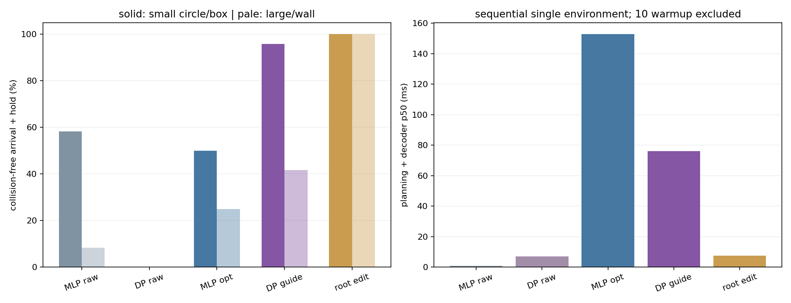

# 경로 힌트 없는 비용 유도: 범위·MLP 대조·실행 진단

2026-11-05 · 사용자 위임으로 AI 구현·CPU 검사·GPU 물리 평가·분석·영상 제작. 기존 모델과 최종 결과 보존.

## 이번에 완료한 세 가지

1. 원형·상자 크기별 무충돌 도착·정지를 집계하고, 넓은 벽은 별도 스트레스 조건으로 보고했다.
2. MLP 출력 최적화의 속도 폭주를 제한하고 Diffusion과 같은 정보·비용·실행기에서 재평가했다.
3. 같은 장면의 실제 물리 실행과, 실제 현재 상태에서 계산한 유도 전후 root 예측을 오차·접촉·계산 시간과 함께 시각화했다.

새 가중치 학습은 0회다. 모델 교체나 점수 상승을 완료 조건으로 삼지 않았으며 실패와 악화도 함께 기록한다.

## 비교 방법과 선택

생성기는 기존 H60 MLP·Diffusion, 실행기는 같은 frozen learned action decoder다. 같은 2초 horizon에서 첫 1초 root 특성을 사용하고 매 physics step 실제 상태로 재계획한다. 예측 action head·관절 자세를 그대로 실행하지 않는다. 기존 목표 관측 단계 전환 보조는 공통으로 유지했다.

MLP는 9개 knot의 가속도·회전가속도를 최적화하고 시간 적분으로 XY·yaw를 만든다. 속도 2m/s, 회전속도 1.5rad/s, 가속도 6m/s², 회전가속도 8rad/s²를 제한한다. 과거의 프레임별 자유 XY 수정과 달리 경로·속도 차분이 일치한다. 이것은 root 운동학 제한이며 전신 동역학 실행 가능성의 증명은 아니다. 초기 실제 속도가 제한 밖이면 첫 예측 전이도 따로 해석해야 한다.

두 방법에 동일한 geometry SDF 비용·진행/일관성/방향 비용·terminal velocity preview·실행 가능성 비용을 제공했다. Diffusion에는 같은 제한값의 soft penalty를 denoising 비용으로 적용했고 생성 후 root 보정은 하지 않았다. MLP의 hard parameterization과 Diffusion의 soft guidance는 다르므로 동일한 최적화 알고리즘이나 계산 예산이라고 부르지 않는다.

Train 12상태에서 MLP learning rate .05/.15, Diffusion guidance scale 15/30을 비교했다. 방법별 성공 수→낙상→보수적 충돌 순으로 선택하고 동률이면 먼저 등록한 설정을 사용했다. 후속 장면 결과를 보고 다시 튜닝하지 않았다.

```json
{
  "M1": {
    "flag": "--lr",
    "value": 0.05,
    "candidates": [
      {
        "value": 0.05,
        "successes": 3,
        "falls": 8,
        "collisions": 8
      },
      {
        "value": 0.15,
        "successes": 2,
        "falls": 8,
        "collisions": 8
      }
    ]
  },
  "D2": {
    "flag": "--guide-scale",
    "value": 15,
    "candidates": [
      {
        "value": 15,
        "successes": 7,
        "falls": 2,
        "collisions": 5
      },
      {
        "value": 30,
        "successes": 6,
        "falls": 2,
        "collisions": 6
      }
    ]
  }
}
```

## 같은 장면 결과

| 방법 | 전체 | 작은 원형·상자 | 큰 장애물·벽 | 낙상 | p50 / p95 |
| --- | ---: | ---: | ---: | ---: | ---: |
| MLP raw | 8/24 (33.3%) | 7/12 (58.3%) | 1/12 (8.3%) | 8/24 | 0.9 / 1.2 ms |
| Diffusion raw (reused) | 0/48 (0.0%) | 0/24 (0.0%) | 0/24 (0.0%) | 29/48 | 7.1 / 8.2 ms |
| MLP bounded output optimization | 9/24 (37.5%) | 6/12 (50.0%) | 3/12 (25.0%) | 10/24 | 152.7 / 180.9 ms |
| Diffusion cost guidance | 33/48 (68.8%) | 23/24 (95.8%) | 10/24 (41.7%) | 7/48 | 76.1 / 81.5 ms |
| Diffusion analytic root edit | 24/24 (100.0%) | 12/12 (100.0%) | 12/12 (100.0%) | 0/24 | 7.6 / 8.5 ms |

고정된 두 checkpoint의 짝지은 차이는 31.2%p였다. Source 12개를 단위로 재표집한 95% bootstrap 구간은 [4.2, 56.2]%p다. 같은 개발 source·학습 seed 1개의 불확실성만 일부 다루며 architecture 우월성이나 학습 seed 간 재현성을 입증하지 않는다.




24장면은 V1 후속에서 사용한 배치의 재평가다. 초기 상태는 이미 걷는 중인 snapshot이며, 정지 상태에서 새 목표를 받고 출발하는 전체 navigation 성능으로 확대 해석하지 않는다. 생성기 학습 seed는 1개, MLP는 결정론적 24회, Diffusion 유도는 sampling seed 4504/4505의 48회를 모두 집계했다. Raw Diffusion 48회는 같은 조건의 V1 저장 결과를 재사용했으며 새로 실행한 것처럼 세지 않았다. Root 보정 기준선은 sampling seed 4504의 24회다. 모든 arm의 장면·초기 실제 상태·목표·geometry 일치 검사를 통과했다.

Raw 방법과 root 보정은 비용을 사용하는 주 대조군이 아닌 별도 진단 기준선이다. MLP와 DP의 목적 함수는 같지만 표현·최적화 방법·모델 크기·학습 목적·iteration 예산은 다르다. 따라서 architecture 하나만의 인과 효과를 분리한 실험은 아니다.

계산 시간은 병렬 batch 실행 시간이 아니라, 한 환경을 순차 실행하고 CUDA synchronize한 planning+decoder 값이다. 첫 10회는 제외했으며 물리 step·관측 수집·logging은 제외했다. 4초의 짧은 scene0 측정이므로 전체 장면의 latency 분포를 대표한다고 보장하지 않는다.

## 장애물별 관측된 범위

작은 조건은 원형·상자 중 최대 평면 폭이 0.8m 이하인 장면으로 사전 지정했다. 시험 장면은 목표 거리5~6.5m, 목표 위치 방향−25/0/+25도, 장애물 거리2.5~3.5m, 중심선에서 좌우 약0.2~0.45m offset이다. 도착 방향은 초기 몸 방향이다. 정확히 중심선을 막는 대칭 배치·180도 목표·여러 장애물을 평가한 결과로 확대하지 않는다. 아래는 시험한 배치에서의 경험적 범위이며 새 시작 상태·독립 source의 성공 보장은 아니다. 작은 조건과 스트레스 조건은 각각12장면·8개 source group을 사용했다. 각 크기 bin은 작은 수의 장면이므로 성공률만으로 안전 범위를 인증하지 않는다.

| 조건 | MLP 최적화 | Diffusion 유도 |
| --- | ---: | ---: |
| box_width_0.8 | 2/6 (33.3%) | 11/12 (91.7%) |
| box_width_1.2 | 1/2 (50.0%) | 2/4 (50.0%) |
| circle_width_0.4 | 1/3 (33.3%) | 6/6 (100.0%) |
| circle_width_0.8 | 3/3 (100.0%) | 6/6 (100.0%) |
| circle_width_1.2 | 0/2 (0.0%) | 2/4 (50.0%) |
| wall_width_1.4 | 0/4 (0.0%) | 2/8 (25.0%) |
| wall_width_1.8 | 2/4 (50.0%) | 4/8 (50.0%) |

## 속도 폭주는 줄었는가

| 방법 | 계획 속도 p95 평균 | 계획 회전속도 p95 평균 |
| --- | ---: | ---: |
| MLP bounded output optimization | 1.561m/s | 1.494rad/s |
| Diffusion cost guidance | 1.032m/s | 0.646rad/s |

각 episode의 첫 실제 1초 동안 생성한 첫 1초 예측을 모아 p95를 구한 뒤 episode 평균을 냈다. 실제 몸의 속도와 구분한다. V1 MLP의 약 8.64m/s·45.63rad/s 계획 폭주와 같은 정의다. 제한된 root 계획도 decoder가 안정적으로 실행하지 못할 수 있다.

## 실패는 어디서 생겼나

모든 실패에 대해 첫 실제 접촉(없으면 보수적 geometry 충돌) 0.5초 전의 예측을 확인했다. 다음 1초 root SDF가 음수면 이미 장애물 내부를 지나는 생성 계획, 0~0.5m면 계획 안전 여유 부족, 0.5m 이상인데 접촉하면 신체/실행 오차 의심으로 분류했다. Root 경로만으로 팔·발·기울기까지 확인할 수 없고 재계획도 일어나므로 이 분류는 원인 확정이 아닌 재현 가능한 진단이다. 접촉 없는 낙상은 생성·실행 구분 미확정으로 남겼다.

| 방법 | 분류 | 수 |
| --- | --- | ---: |
| M1 | success | 9 |
| M1 | generated_root_enters_obstacle | 1 |
| M1 | generated_plan_insufficient_margin | 10 |
| M1 | safe_root_plan_but_body_execution_contact | 3 |
| M1 | no_contact_fall_generation_execution_unresolved | 1 |
| D2 | success | 33 |
| D2 | generated_plan_insufficient_margin | 6 |
| D2 | no_contact_fall_generation_execution_unresolved | 1 |
| D2 | generated_root_enters_obstacle | 8 |

Episode별 진단 시각·계획 여유·목표 오차·낙상·실제 접촉을 [CSV](assets/guidance_comparison_v2/episodes.csv)에 저장했다. 보수적 충돌과 force proxy 접촉을 구분했다.

## 같은 장면을 보는 자료

영상 선택은 seed4504에서 scene ID순 첫 작은 장애물 DP 성공에 대한 raw DP/MLP/DP, 첫 DP 실패, 그리고 작은 장애물 중 첫 MLP 실패·DP 성공 장면의 쌍이다. 전체 점수는 모든 장면을 포함하며 대표 영상의 차이를 평균 성능으로 대체하지 않는다.

회색은 그 순간의 실제 상태에서 생성한 nominal root, 보라색은 같은 context/noise에서 비용을 적용한 root, 파랑은 실제 실행 궤적이다. MLP의 nominal과 선택 출력도 같은 순간의 예측이다. Raw run과 guided run은 초기 조건은 같지만 이후 실제 상태가 달라지므로 전체 시점이 같은 context인 counterfactual 실험이라고 설명하지 않는다.

영상은 실제 물리 상태를 재렌더링한 것이며 body pose를 생성 예측으로 강제 재생하지 않았다. 예측 선은 root만 보여준다. 각 영상은 첫 20초까지만 포함하고, 전체 episode의 위치·방향·충돌·예측 여유는 timeline 그림에 남겼다. Overlay의 지연은 batch 값으로 표시하며 정식 latency는 위 단일 환경 측정값을 사용한다.

- **D0_reused scene0 / 실패:** [영상](assets/guidance_comparison_v2/D0_reused_scene00_FAIL_analysis.mp4) · [4시점 프레임](assets/guidance_comparison_v2/D0_reused_scene00_FAIL_frames.jpg) · [전체 timeline](assets/guidance_comparison_v2/D0_reused_scene00_FAIL_timeline.png)
- **M1 scene0 / 성공:** [영상](assets/guidance_comparison_v2/M1_scene00_PASS_analysis.mp4) · [4시점 프레임](assets/guidance_comparison_v2/M1_scene00_PASS_frames.jpg) · [전체 timeline](assets/guidance_comparison_v2/M1_scene00_PASS_timeline.png)
- **D2 scene0 / 성공:** [영상](assets/guidance_comparison_v2/D2_scene00_PASS_analysis.mp4) · [4시점 프레임](assets/guidance_comparison_v2/D2_scene00_PASS_frames.jpg) · [전체 timeline](assets/guidance_comparison_v2/D2_scene00_PASS_timeline.png)
- **D2 scene2 / 실패:** [영상](assets/guidance_comparison_v2/D2_scene02_FAIL_analysis.mp4) · [4시점 프레임](assets/guidance_comparison_v2/D2_scene02_FAIL_frames.jpg) · [전체 timeline](assets/guidance_comparison_v2/D2_scene02_FAIL_timeline.png)
- **M1 scene4 / 실패:** [영상](assets/guidance_comparison_v2/M1_scene04_FAIL_analysis.mp4) · [4시점 프레임](assets/guidance_comparison_v2/M1_scene04_FAIL_frames.jpg) · [전체 timeline](assets/guidance_comparison_v2/M1_scene04_FAIL_timeline.png)
- **D2 scene4 / 성공:** [영상](assets/guidance_comparison_v2/D2_scene04_PASS_analysis.mp4) · [4시점 프레임](assets/guidance_comparison_v2/D2_scene04_PASS_frames.jpg) · [전체 timeline](assets/guidance_comparison_v2/D2_scene04_PASS_timeline.png)

## 검증·한계·판단

직접 확인한 대표 장면: scene0의 raw DP는 원통에 막힌 뒤 약6.6초에 넘어졌고, 같은 시작 상태의 MLP 최적화와 DP 유도는 우회 후 정지를 유지했다. Scene4의 MLP는 상자 근처에서 예측 여유가 줄고 접촉·정체 후 약8.7초에 넘어졌으며, DP 유도는 상자를 지나 목표로 이동했다. Scene2의 DP 실패는 벽에 붙어 진행하지 못한45초 timeout이다. 이 실패를 정지 동작 낙상으로 잘못 분류하지 않는다. 영상6개를 전체decode(2718프레임)하고 6개 frame sheet의24개 프레임을 직접 확인했다. 모든 프레임을 눈으로 검토했다고 주장하지 않는다.

제약 보완 MLP는9/24로 과거 비제약 대조0/24의 속도 폭주를 피했지만, 같은 후속 장면의 raw MLP8/24에 비해 성공이1개 늘고 낙상은8→10개로 증가했다. 따라서 새 MLP를 안정성이 개선된 기본 모델로 자동 채택하지 않았다. Diffusion 유도33/48도 기존 V1 32/48보다1개 늘어난 수준이며 비용·강도 변경을 포함한다. 작은 수치 차이만으로 전반적인 모델 개선을 주장하지 않는다.

새 scored 물리실험 168회(train48+후속120), 단일 환경 profile5회. 기존 raw DP48회 재사용. 학습 update0. subprocess wall 합 1719.1초는 최대2process 합산값이며 전체 경과 시간이나 GPU 단독 사용 시간이 아니다. CPU14검사를 통과했고 공통 실행 가능성 비용의 별도 방향미분 검사 오차는 약6.1e-11이었다. 기존 모델·dataset·release 결과를 보존했다.

이번 작업은 세 가지 검증과 설명자료의 완료다. 새 모델이 더 좋거나 완전한 회피 시스템이 되었다는 뜻은 아니다. 기존 V1 유도32/48과 새 동일비용 조건은 달라 구분해 보고한다. 개발 source를 공유하고 이전에 본 장면을 재사용했으므로 독립 test 일반화, 실제 로봇, Diffusion 필수성, 학습 seed 간 재현성을 주장하지 않는다.

이후 개선이 필요하면 train에서 좌우 우회 경험과 생성 다양성을 검사하고, 실행 가능한 자료가 부족한 경우 같은 decoder로 검증해 보강한다. 후속 장면에 맞춘 반복 튜닝 대신 새 source·장면을 고정한 평가가 필요하다. 이번에는 추가 자료 수집과 가중치 학습을 수행하지 않았다.

[V1 후속](../docs/development_notes.md) · [기존 전체 비교](../docs/development_notes.md) · [실험 기록](../docs/development_notes.md)

## 고정된 설정으로 다시 평가

가중치·외부 환경·원본 source가 기존 로컬 경로에 있는 경우의 명령이다. 새 출력 폴더가 필요하다. 분석 코드는 scripts/analyze_guidance_comparison_v2.py, 영상 제작 코드는 scripts/render_guidance_comparison_v2.py다. 영상 스크립트는 기존 visuals 폴더가 있으면 덮어쓰지 않고 중단한다. 정확한 이번 실행 명령과 one-off 집계 도구는 로컬 실험 폴더에도 보존했다.

```bash
cd /home/an/Desktop/project_alpha
/home/an/miniconda3/envs/issaclab/bin/python scripts/run_guidance_comparison_v2.py --arm M1 --variant legacy --manifest configs/releases/guidance_comparison_v2_manifest.json --scene-file reports/assets/guidance_comparison_v2/scenes.json --source-shift 15 --seed 4504 --lr 0.05 --out-dir outputs/my_comparison_v2_M1
/home/an/miniconda3/envs/issaclab/bin/python scripts/run_guidance_comparison_v2.py --arm D2 --variant legacy --manifest configs/releases/guidance_comparison_v2_manifest.json --scene-file reports/assets/guidance_comparison_v2/scenes.json --source-shift 15 --seed 4504 --guide-scale 15 --out-dir outputs/my_comparison_v2_D2
```


공개 정리본: 원본 V2 보고서의 결과·그림은 유지하고 로컬 과거 기록 링크만 개발 요약으로 연결했다. 원본과 freeze 기록은 로컬에 보존한다.
